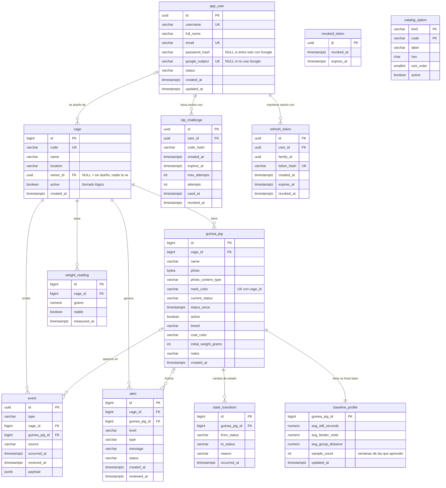

# cuy-monitor-db

Esquema de PostgreSQL del Monitor de Salud de Cuyes. Las migraciones **Flyway** son la única forma de crear o cambiar tablas; el backend (`cuy-monitor-backend`) no crea nada, solo valida.

## La base de datos en números

| | |
|---|---|
| **Tablas de negocio** | **12** |
| Tabla técnica de Flyway (`flyway_schema_history`) | 1 (13 tablas en total en PostgreSQL) |
| Relaciones (claves foráneas) | **11** |
| Migraciones | **14** (`V1` a `V14`) |
| Motor | PostgreSQL 18 (Amazon RDS en producción) |

Las 12 tablas se reparten en dos áreas: **usuarios y sesión** (4) y **jaula y salud** (8).

## Diagrama de relaciones



`catalog_option` no tiene claves foráneas: `guinea_pig.mark_color`, `breed` y `coat_color` guardan el **código** de
una opción del catálogo (`RED`, `TEDDY`…) y el backend revisa que exista, así una opción retirada no borra la
historia de los cuyes que la usaban.

`revoked_token` no tiene relaciones a propósito: guarda el `jti` (y el id de sesión) de los JWT cerrados, que no pertenecen a una fila de otra tabla, y un job diario borra los vencidos. `refresh_token.family_id` agrupa los tokens de un mismo inicio de sesión (para revocarlos juntos si se reutiliza uno) y tampoco es una clave foránea.

## Las 12 tablas

### Usuarios y sesión

| Tabla | Migración | Para qué sirve |
|---|---|---|
| `app_user` | V2, V7 | Cuentas de quien mira el dashboard (un solo tipo de usuario). Entra con contraseña, con Google o ambas |
| `otp_challenge` | V2 | Códigos de un solo uso del inicio de sesión (guardados hasheados, con intentos y vencimiento) |
| `refresh_token` | V6 | Tokens de renovación de sesión (hasheados, con rotación y familias) |
| `revoked_token` | V5 | JWT cerrados antes de vencer (lista de revocación) |

### Jaula y salud

| Tabla | Migración | Para qué sirve |
|---|---|---|
| `cage` | V1, V3, V12 | Cada jaula del criador. Se identifica por un `code` (`cage-1`) que usan las cámaras y el dashboard; tiene dueño (`owner_id`) y borrado lógico (`active`) |
| `catalog_option` | V10 | Las listas que el criador puede cambiar sin tocar código: colores de marca, razas y colores de pelaje (código, etiqueta en español, color y orden) |
| `guinea_pig` | V4, V8, V10, V11 | Cada cuy: su foto, color de marca (único por jaula), estado actual, y opcionalmente raza, color del pelaje, peso inicial y notas |
| `event` | V4 | Eventos que llegan de cámara, micrófono y báscula (`BEHAVIOR`, `AUDIO`, `WEIGHT`), con el JSON original en `payload` |
| `state_transition` | V4 | Historial de cambios de estado de cada cuy (`NORMAL`, `OBSERVED`, `ALERT`, `CRITICAL`) y su motivo |
| `alert` | V4, V14 | Alertas abiertas o revisadas; pueden ser de un cuy o de toda la jaula (`guinea_pig_id` nulo). Se consultan en el historial por jaula o por cuy, de la más nueva a la más vieja |
| `weight_reading` | V4 | Lecturas de la báscula de la jaula |
| `baseline_profile` | V4, V13 | Lo normal de cada cuy (quietud, visitas al comedero, distancia al grupo), aprendido de sus propias ventanas normales; `sample_count` dice de cuántas. 1 a 1 con `guinea_pig` |

## Relaciones (las 11 claves foráneas)

| Tabla origen | Columna | Apunta a | Restricción |
|---|---|---|---|
| `otp_challenge` | `user_id` | `app_user(id)` | `fk_otp_challenge_user` |
| `refresh_token` | `user_id` | `app_user(id)` | `fk_refresh_token_user` |
| `cage` | `owner_id` | `app_user(id)` | `fk_cage_owner` |
| `guinea_pig` | `cage_id` | `cage(id)` | `fk_guinea_pig_cage` |
| `event` | `cage_id` | `cage(id)` | `fk_event_cage` |
| `event` | `guinea_pig_id` | `guinea_pig(id)` | `fk_event_guinea_pig` (opcional) |
| `state_transition` | `guinea_pig_id` | `guinea_pig(id)` | `fk_state_transition_guinea_pig` |
| `alert` | `cage_id` | `cage(id)` | `fk_alert_cage` |
| `alert` | `guinea_pig_id` | `guinea_pig(id)` | `fk_alert_guinea_pig` (opcional) |
| `weight_reading` | `cage_id` | `cage(id)` | `fk_weight_reading_cage` |
| `baseline_profile` | `guinea_pig_id` | `guinea_pig(id)` | `fk_baseline_profile_guinea_pig` (es también su clave primaria) |

Restricciones de unicidad: `app_user` (`username`, `email`, `google_subject`), `cage.code`, `refresh_token.token_hash` y `guinea_pig (cage_id, mark_color)` entre los cuyes **activos** (índice único parcial), que impide dos cuyes con la misma marca en una jaula; un cuy eliminado libera su color.

Los valores permitidos de cada enumeración (`HealthStatus`, `MarkColor`, raza, color del pelaje…) se validan con `CHECK`, no con tipos `ENUM`. Columnas, tipos y restricciones completas en [`docs/ARCHITECTURE.md`](docs/ARCHITECTURE.md).

## Migraciones

| Versión | Descripción |
|---|---|
| V1 | Esquema inicial (`cage`) |
| V2 | `app_user` y `otp_challenge` |
| V3 | Código de la jaula (`cage.code`) |
| V4 | Tablas de salud: `guinea_pig`, `event`, `state_transition`, `alert`, `weight_reading`, `baseline_profile` |
| V5 | `revoked_token` |
| V6 | `refresh_token` |
| V7 | Inicio de sesión con Google (`password_hash` opcional, `google_subject`) |
| V8 | Raza, color del pelaje, peso inicial y notas del cuy |
| V9 | Un cuy eliminado (borrado lógico) libera su color: unicidad solo entre los activos |
| V10 | `catalog_option`: colores de marca, razas y colores de pelaje salen de la base, no del código |
| V11 | El cuy se registra con su foto en lugar de un nombre (`photo`, `photo_content_type`) |
| V12 | Varias jaulas por cuenta: dueño (`owner_id`) y borrado lógico (`active`) de la jaula |
| V13 | `baseline_profile.sample_count`: de cuántas ventanas se aprendió lo normal de cada cuy |
| V14 | Índice `ix_alert_guinea_pig_created` para el historial de alertas de un cuy |

Además hay un seed solo para desarrollo (`seeds/dev/R__dev_seed.sql`), que nunca se aplica en producción.

## Datos de demostración

`seeds/demo/demo_data.sql` llena la jaula `cage-1` con 4 cuyes, 80 ventanas de comportamiento, alertas abiertas y revisadas, historial de estados y pesos, para mostrar el dashboard sin cámara ni báscula. Nunca se aplica solo (no es una migración ni va en la imagen `migrate`); se corre con `psql -f` y se puede repetir. Sus filas se reconocen porque las notas del cuy empiezan con `[demo]` y los eventos tienen `source = demo-seed`. `seeds/demo/remove_demo_data.sql` las borra y deja solo los datos reales.

## Estructura

| Ruta | Contenido |
|---|---|
| `migrations/` | Migraciones `V{n}__descripcion.sql` (se aplican en todos los entornos) |
| `seeds/dev/` | Datos de prueba, solo desarrollo |
| `seeds/demo/` | Datos de demostración (cuyes, alertas, historial) que se cargan **a mano** para una presentación, y el script que los quita |
| `scripts/` | Entrada de la imagen de migración |
| `docs/` | `PRD.md`, `ARCHITECTURE.md` (diccionario de datos) |

## Decisiones de diseño

Aquí no hay patrones GoF: esto es SQL. Lo que sí hay son decisiones de modelado que sostienen los patrones de los
otros repos, y conviene saber cuáles son y por qué.

| Decisión | Dónde | Por qué |
|---|---|---|
| **Tabla de catálogo** en vez de valores quemados | `catalog_option` (V10) | Colores de marca, razas y colores de pelaje viven en la base con su etiqueta y su hex. Cambiar «Rojo» por «Rojo carmesí» es un `UPDATE`, no un despliegue del frontend |
| **Enums como `VARCHAR` + `CHECK`** | `health_status`, `event_type`, `alert_status` | `CREATE TYPE ... AS ENUM` es caro de migrar en Postgres. Un `CHECK` se cambia con un `ALTER` |
| **Borrado suave** | `guinea_pig.active`, `cage.active` (V12) | Un cuy o una jaula que se quitan conservan sus eventos, alertas e historial |
| **Índice único parcial** | `uq_guinea_pig_cage_color ... WHERE active` (V9) | Dos cuyes activos no pueden compartir color en la misma jaula, pero el color de uno dado de baja queda libre otra vez |
| **Migraciones inmutables** | `migrations/` | Flyway guarda el checksum de cada una. Una migración en `main` no se edita nunca; se corrige con la siguiente |

### El catálogo es el que más se nota

Antes de V10, la lista de colores estaba escrita tres veces: en un `CHECK` de la base, en los contratos del backend
y en el frontend. V10 la dejó en un solo sitio y borró los tres `CHECK` de `mark_color`, `breed` y `coat_color`.

La contrapartida, dicha con todas las letras: **la base ya no rechaza un color inválido.** El backend es quien valida
contra las filas activas de `catalog_option`. Quien escriba directo con `psql` puede meter un color que no existe.

## Uso local

```bash
docker compose up -d                    # Postgres 18 + Flyway, aplica migrations/ y seeds/dev/
docker compose run --rm flyway info     # qué migraciones están aplicadas
docker compose run --rm flyway validate # verifica los checksums
docker compose down                     # los datos quedan en el volumen (down -v los borra)
```

Conexión local: `jdbc:postgresql://localhost:5432/cuymonitor`, usuario y contraseña `cuymonitor`.

La semilla de desarrollo trae la cuenta `dev` / `dev-password` (ya activa), la jaula `cage-1` con un cuy por color
de marca, una segunda jaula, eventos, pesos y 30 días de alertas revisadas para el historial.

## Producción (Amazon RDS)

- **Dónde:** RDS PostgreSQL 18 (`db.t3.micro`, 20 GB, `us-east-1`), privada: solo la EC2 llega a ella, con TLS.
- **Cómo se aplican las migraciones:** en cada despliegue (`infra/deploy.sh` del backend), Compose corre una vez
  la imagen `migrate` de este repo (`Dockerfile`: Flyway + `migrations/`). El backend arranca solo si `migrate`
  terminó bien. `seeds/` nunca entra en esa imagen.
- **Respaldos:** automáticos diarios de RDS (hoy con 1 día de retención, recomendado 7), snapshots manuales antes
  de cambios grandes y `scripts/backup.sh` / `scripts/restore.sh` para la base local. Todo en
  [docs/BACKUP.md](docs/BACKUP.md).
- **Ahorrar créditos:** la RDS se puede detener cuando el proyecto no se está mostrando (AWS la vuelve a encender
  sola a los 7 días); los datos se conservan.

## Diagrama para el informe

[docs/er-diagram.png](docs/er-diagram.png) es el mismo diagrama de relaciones de arriba exportado a imagen,
para pegarlo en el informe.

## Reglas

- Nunca edites una migración que ya está en `main`; crea `V{n+1}`.
- Cada migración nueva actualiza el diccionario de datos en `docs/ARCHITECTURE.md` **y este README** (conteo de tablas, relaciones y diagrama).
- Commits en Conventional Commits; `main` solo por Pull Request.

Más detalle en `AGENTS.md`, `docs/PRD.md` y `docs/ARCHITECTURE.md`.
